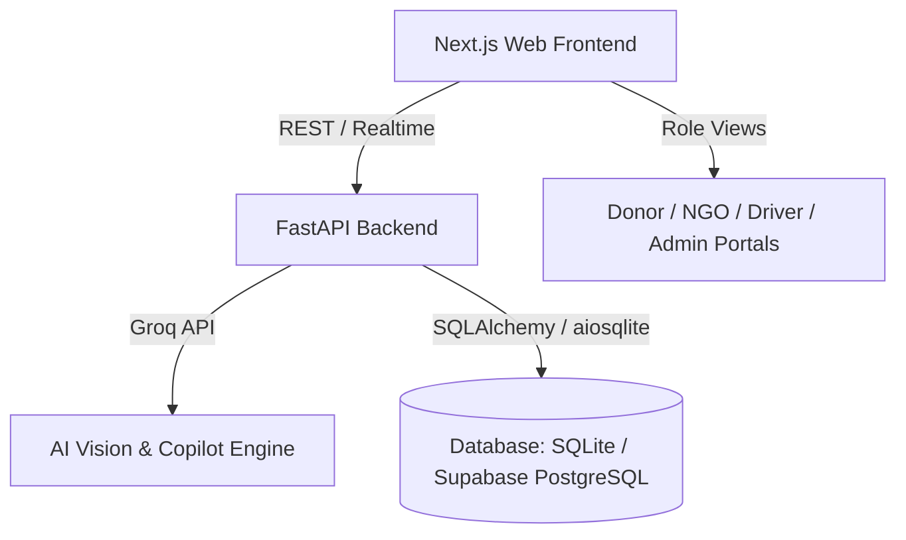

# ANNASETU (अन्नसेतु) 🌾🍲

> **Connecting Surplus Food to Verified Need**  
> An AI-driven, hyper-local surplus food rescue & redistribution marketplace platform connecting donors (restaurants, caterers, banquets), verified NGOs/shelters, and volunteer drivers in real time.

---

## 🚀 Key Features

- **🤖 AI-Powered Food Intake & Inspection**:
  - Image recognition & sensory shelf-life estimation powered by Groq LLM / vision.
  - Automated food categorization, allergen flagging, and spoilage risk calculation.
- **⚡ Smart Matching Engine**:
  - Multi-factor urgency algorithm balancing donor expiry timers, travel distance, NGO hunger vulnerability index, and dietary compatibility.
- **🚚 Intelligent Logistics & Driver Dispatch**:
  - Dynamic route matching and proof-of-pickup / proof-of-delivery (QR code verification).
  - Live order tracking and delivery status dashboard.
- **🛡️ Trust Chain & Governance**:
  - End-to-end transparent food audit trail with immutable logs.
  - Role-based access control for Donors, NGOs, Drivers, and Platform Admins.
- **📊 Real-Time Impact Metrics**:
  - Quantified environmental & social impact: Total Meals Rescued, CO₂ Emissions Averted, Water Footprint Saved, and Beneficiaries Served.

---

## 🛠️ Architecture & Tech Stack



- **Frontend**: Next.js 14+ (App Router), React, TypeScript, Tailwind CSS, Lucide Icons
- **Backend**: FastAPI, Python 3.11+, SQLAlchemy, Pydantic v2, Uvicorn
- **AI / NLP**: Groq API (High-speed vision & intelligence)
- **Database**: Dual support:
  - Local Zero-Config Development: SQLite (`aiosqlite`)
  - Cloud Production: Supabase PostgreSQL
- **Testing**: Pytest & pytest-asyncio

---

## 📂 Project Structure

```bash
annasetu/
├── apps/
│   ├── api/                 # FastAPI backend application
│   │   ├── ai/              # AI vision & prompt pipelines
│   │   ├── allocation/      # Smart allocation algorithms
│   │   ├── delivery/        # Dispatch & logistics routing
│   │   ├── impact/          # ESG & carbon footprint calculator
│   │   ├── models/          # SQLAlchemy schemas
│   │   ├── routers/         # API endpoints (Auth, Donations, Needs, etc.)
│   │   ├── trust_chain/     # Audit & integrity verification
│   │   └── main.py          # FastAPI application entry point
│   └── web/                 # Next.js frontend application
│       ├── app/             # Next.js App Router pages
│       ├── components/      # Role-based UI (Donor, NGO, Driver, Admin)
│       └── lib/             # API client, types & utilities
├── packages/
│   └── shared/              # Shared TypeScript definitions & contracts
├── supabase/
│   ├── migrations/          # SQL database migrations
│   └── seed/                # Seed test data
├── .env.example             # Backend environment template
├── requirements.txt         # Python dependencies
└── README.md
```

---

## ⚡ Getting Started

### 1. Prerequisites
- Python 3.10+
- Node.js 18+ & npm
- Git

### 2. Clone the Repository
```bash
git clone https://github.com/ASR-C/ANNASETU.git
cd ANNASETU
```

### 3. Backend Setup (FastAPI)
```bash
# Create and activate virtual environment
python -m venv .venv

# On Windows:
.venv\Scripts\activate
# On Linux/macOS:
source .venv/bin/activate

# Install dependencies
pip install -r requirements.txt

# Configure environment variables
cp .env.example .env

# Run FastAPI server (defaults to http://localhost:8000)
python -m uvicorn apps.api.main:app --reload
```
Interactive API documentation will be available at:
- Swagger UI: `http://localhost:8000/docs`
- Redoc: `http://localhost:8000/redoc`

### 4. Frontend Setup (Next.js)
```bash
cd apps/web

# Install packages
npm install

# Configure environment variables
cp .env.example .env.local

# Run Next.js development server (defaults to http://localhost:3000)
npm run dev
```

---

## 🧪 Running Tests

```bash
# Run backend test suite
pytest
```

---

## 📄 License
This project is licensed under the [MIT License](LICENSE).
